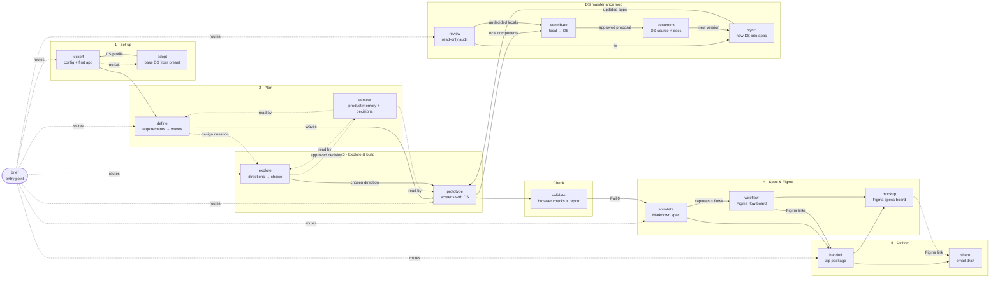

# nnminh-prototype-kit

Claude Code skills that take a design from idea to developer handoff with **any design system**: plan the work, build HTML, React or Vue prototypes with the DS, write the spec, put the flows on Figma, and package everything for BA, QC and developers.

No design system yet? `adopt` builds a base one from a public preset (shadcn by default) with your brand colour, for web, mobile and tablet.

## Install

In Claude Code:

```
/plugin marketplace add MinhNhat0201/nnminh-prototype-kit
/plugin install kit@nnminh-prototype-kit
```

Skills are then available as `/kit:<skill>`, and Claude also picks them up from plain requests such as "build the settings screen" or "package feature 1234 for QC".

Requirements: Python 3.9+, Node 18+, Playwright with Chromium for screen capture and browser checks, Pillow for image optimisation and screenshot comparison. Optional: `axe-core` in the project (`npm i -D axe-core`) for the accessibility checks of `validate`. The Figma skills need the Figma connector; `share` needs a mail connector.

## Quick start

```
/kit:brief      I want to prototype a task manager for our team
```

`brief` asks one or two questions and sends you to the right skill. A new project usually goes:

1. `/kit:adopt`: only if you have no DS. Pick a brand colour, name and radius; get a DS profile in `ds/<name>/`.
2. `/kit:kickoff`: choose language, stack (`html`, `react`, `vue`) and the DS. Creates `kit.config.json`, the first app and a project `CLAUDE.md`.
3. `/kit:define`: turn PM/BA requirements into questions, waves and a traceability matrix.
4. `/kit:explore`: when a wave has a real design question, build 2–3 directions with the DS, compare them side by side and let the team choose one.
5. `/kit:prototype`: build screens with DS components only, from the chosen direction. It asks before creating new components or pages.
6. `/kit:annotate`, `/kit:wireflow`, `/kit:handoff`, `/kit:share`: spec, Figma flow board, zip package, email draft.

## Skills

### Skill map



Solid arrows are the usual order of work; dotted arrows are routing or optional links. The DS loop runs whenever the DS or the local components change, alongside the main flow.

| Skill | What it does |
|---|---|
| `brief` | Entry point: understands the request and routes to the right skill |
| `kickoff` | Sets up a project: config, DS link, stack, first app |
| `adopt` | Builds a base DS from a preset (shadcn) plus Material 3 structure for mobile and tablet |
| `define` | Requirement analysis, questions for PM/BA, delivery waves, traceability |
| `context` | Product memory every skill reads: overview, personas, UX principles, business rules, constraints, and a decision log with statuses (observed → proposed → approved → implemented → verified) |
| `explore` | Two to four design directions built with the DS, a comparison page and a recorded human decision before building |
| `prototype` | Builds screens and flows with the DS; component and new-page gates |
| `validate` | Browser checks of a prototype in one report: errors, overflow, accessibility (axe-core), keyboard focus, touch targets, states, flows, visual changes against a baseline; failures separated from items a human must judge |
| `annotate` | Markdown spec per unit with screen captures, pins, token-level style notes and flows |
| `wireflow` | Flow board on Figma from captures; updates in place so shared links keep working |
| `mockup` | Rebuilds screens on Figma with auto layout, DS components and variables, with an automatic audit |
| `handoff` | One zip for BA, QC and developers: spec, checklists, changelog, AGENTS.md, scoped prototype |
| `share` | Drafts the handoff email (never sends) |
| `review` | Read-only audit of an app against the DS, with remediation options |
| `sync` | Brings a new DS version into apps |
| `contribute` | Reviews local components and proposes them to the DS (two approval gates) |
| `document` | Writes and maintains DS documentation and tokens |

## How it adapts to your project

Two files, no hard-coded design system:

- `kit.config.json` in the project: language of replies and documents, stack, apps, local-component prefix, handoff and email settings. See [docs/config.md](docs/config.md).
- `ds/<name>/ds.json` in the DS profile: token prefix and roles, CSS bundle, theming attributes, version label, Figma libraries. Made by `adopt`, or written by hand for an existing DS.

Stacks are described in [docs/stacks.md](docs/stacks.md). Each app can override the project stack, so old HTML apps and new Vue apps can live side by side.

## Languages

The kit is written in English. Replies and generated documents follow `kit.config.json > language`; English and Vietnamese templates ship in `locales/`. To add a language, copy `locales/en/` to `locales/<code>/` and translate the values.

## Contributing

Read [docs/authoring.md](docs/authoring.md) before adding or changing a skill.

## Licence

MIT. The shadcn preset is derived from shadcn/ui and shadcn-vue (MIT); see `presets/shadcn/NOTICE`. Profiles made by `adopt` carry their own `NOTICE`.
