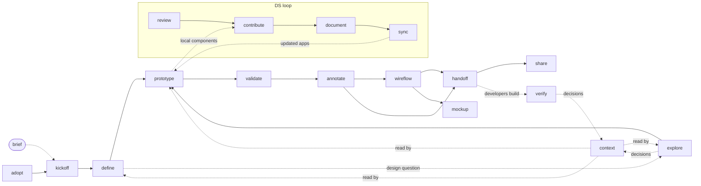

# Prototype Kit

Prototype Kit is a Claude Code plugin with 18 skills for design work, from requirement to developer handoff. It plans the work, builds HTML, React or Vue prototypes with your design system (DS), checks them in the browser, writes the spec, puts the flows on Figma and packages everything for BA, QC and developers. After development, it compares the developers' build with the approved prototype.

The kit works with any DS. Each project points the kit at its DS through `kit.config.json` and a profile in `ds/<name>/`. No DS yet? `adopt` builds a base one from a preset.

A person makes every design decision. The kit does the work, runs the checks and records who decided what, and why.

Website: [nnminh-prototype-kit.vercel.app](https://nnminh-prototype-kit.vercel.app) · Repository: `MinhNhat0201/nnminh-prototype-kit`

## Install

In Claude Code:

```
/plugin marketplace add MinhNhat0201/nnminh-prototype-kit
/plugin install kit@nnminh-prototype-kit
```

Call a skill as `/kit:<skill>`. Claude also picks the right skill from a plain request, such as "build the settings screen" or "package feature 1234 for QC".

## Requirements

| Need | For |
|---|---|
| Python 3.9+, Node 18+ | All scripts |
| Playwright with Chromium | Screen capture, `validate`, `verify`, `pkg.py smoke` |
| Pillow | Image optimisation, screenshot comparison |
| axe-core (optional) | Accessibility checks in `validate`. Install it in the project (`npm i -D axe-core`). A project without `package.json` points to a copy with `--axe`, `KIT_AXE_PATH` or `validate.axePath`. |
| Figma connector | `wireflow`, `mockup` |
| Mail connector | `share` |

## Quick start

```
/kit:brief  I want to prototype a task manager for our team
```

`brief` asks one or two questions and sends you to the right skill. A new project usually goes like this:

1. `/kit:adopt`: only if you have no DS. Pick a brand colour, name and radius.
2. `/kit:kickoff`: choose the language, stack (`html`, `react` or `vue`) and DS. It writes `kit.config.json`, the first app and a project `CLAUDE.md`.
3. `/kit:define`: turn PM or BA requirements into questions, delivery waves and a traceability matrix.
4. `/kit:explore`: when a wave has an open design question, compare two to four directions and choose one.
5. `/kit:prototype`: build the screens with DS components. Then `/kit:validate` checks them in the browser.
6. `/kit:annotate`, `/kit:wireflow`, `/kit:handoff`, `/kit:share`: spec, Figma flow board, zip package, email draft.
7. `/kit:verify`: compare the developers' build with the approved prototype.

## Skills

| Skill | What it does |
|---|---|
| `brief` | Entry point. Finds out which job the request is and routes it. |
| `adopt` | Builds a base DS from a preset (shadcn or atelier), with Material 3 structure for mobile and tablet. |
| `kickoff` | Sets up a project: config, DS link, stack, first app. |
| `context` | Keeps product memory: overview, personas, UX principles, business rules, decision log, rules registry. |
| `define` | Splits requirements into units, questions for PM or BA, waves and a traceability matrix. To port an existing page, `extract_rules.py` drafts a parity checklist. |
| `explore` | Builds two to four design directions with the DS and records the chosen one. |
| `prototype` | Builds screens and flows with the DS. Asks before any new component or page. A ported page ends with a parity check. |
| `validate` | Checks a prototype in the browser: errors, overflow, accessibility, focus, touch targets, states, flows, visual changes. Named states cover brand themes and 200% text. Known findings can be waived with a reason, and each finding is marked new or carried over. |
| `annotate` | Writes a Markdown spec per unit, with captures, pins, token-level style notes and flows. |
| `wireflow` | Puts a flow board on Figma and updates an existing board in place, so shared links keep working. |
| `mockup` | Rebuilds screens on Figma with auto layout, DS components and variables, then audits them. |
| `handoff` | Builds one zip for BA, QC and developers. `pkg.py relink` adds Figma links to a draft package; `pkg.py smoke` opens the unpacked package in Chromium. |
| `share` | Drafts the handoff email. It never sends. |
| `verify` | Compares the developers' build with the approved prototype. Each difference is a defect or an approved deviation. |
| `review` | Two read-only modes: audits an app against the DS and proposes fixes, or critiques one screen or flow with a screen-type checklist. |
| `sync` | Brings a new DS version into the apps. |
| `contribute` | Scores local components and proposes them to the DS, with two approval gates. |
| `document` | Maintains DS tokens, components and documentation. |

Review checklists ship with the skills: accessibility for web and mobile ([validate/references](skills/validate/references)), states and edge data ([prototype/references](skills/prototype/references)), motion, a heuristics rubric and 15 screen-type checklists such as sign-in, form, table, settings and long AI tasks ([review/references](skills/review/references)).

### Skill map



Solid arrows show the usual order of work. Dotted arrows show routing or optional links. The DS loop runs whenever the DS or the local components change. `brief` can route to any skill.

## People decide, the kit checks

| A person decides | Where |
|---|---|
| The plan and its waves, before anything is built | `define` |
| One design direction, with the reason | `explore` |
| Every new component and every new page | `prototype` |
| A local component proposed to the DS, then accepted into it | `contribute` |
| A difference between the build and the design, accepted as intended | `verify` |
| Anything sent to people | `share` only drafts. Nothing is sent, published or merged without you. |

Decisions move through `observed → proposed → approved → implemented → verified` (or `rejected`, `superseded`). Skills read them before they plan or build.

Rules live in a registry, one small file per rule, in kit, DS, project and app layers. Skills load only the rules for the current app and step (`rules.py list --app <app> --skill <skill>`). `review` and `validate` run the rules that have an automated check.

## Configuration

| Topic | Read |
|---|---|
| `kit.config.json`, the DS profile (`ds.json`), project commands, the folders the kit writes, languages | [docs/config.md](docs/config.md) |
| The rules registry: layers, rule files, `rules.py` commands | [docs/rules.md](docs/rules.md) |
| Stacks (`html`, `react`, `vue`), DS Vue layers, a Vue page inside a multi-page html app | [docs/stacks.md](docs/stacks.md) |

Each app can override the project stack and DS profile. HTML and Vue apps, or web and mobile profiles, can live side by side.

## Contributing

Read [docs/authoring.md](docs/authoring.md) before you add or change a skill. Before a release, run:

```
python3 tests/e2e.py
```

It runs every script's `--selftest`, then builds a throw-away project from `adopt` to a handoff zip and an email draft. It needs Node, Playwright and an installed Chromium.

## Licence

MIT. The shadcn preset is derived from shadcn/ui and shadcn-vue (MIT); see `presets/shadcn/NOTICE`. The atelier preset comes from the author's own design system (MIT; the fonts Geist and Manrope are named, not bundled); see `presets/atelier/NOTICE`. Profiles made by `adopt` carry their own `NOTICE`.
